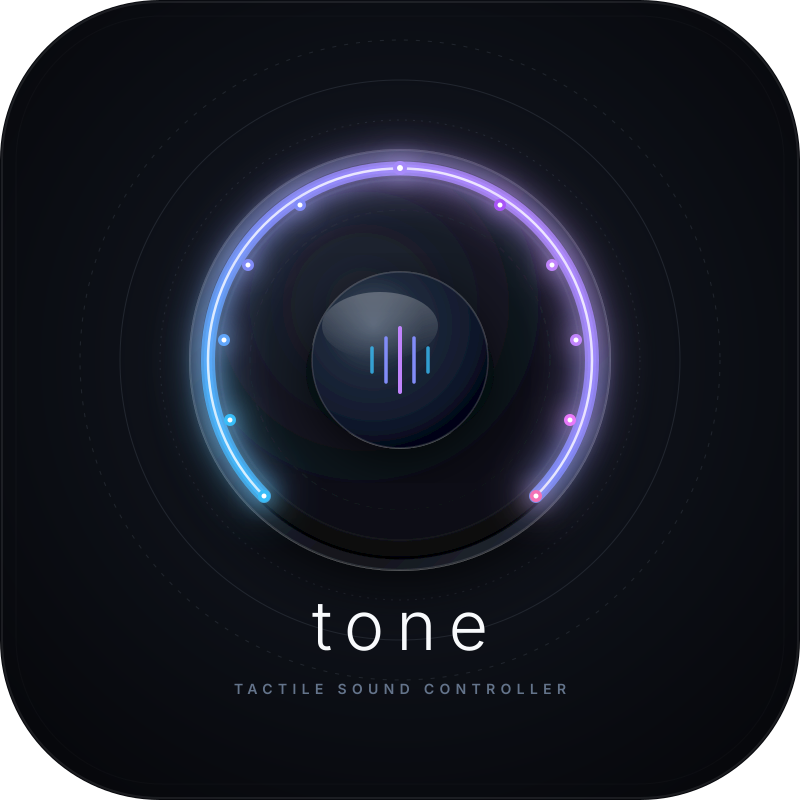
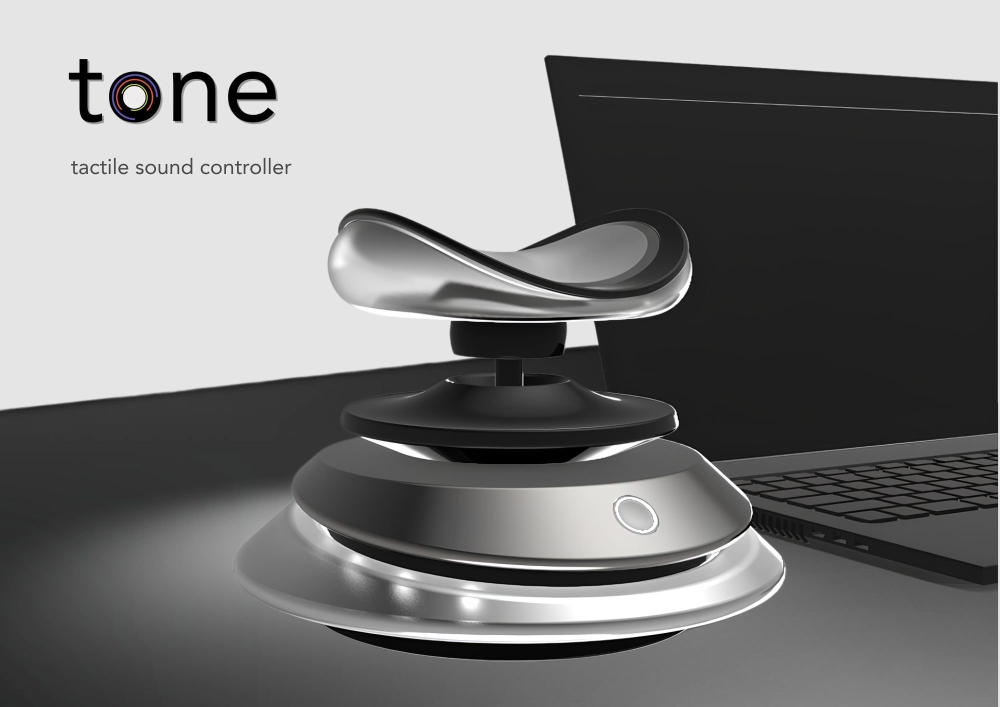
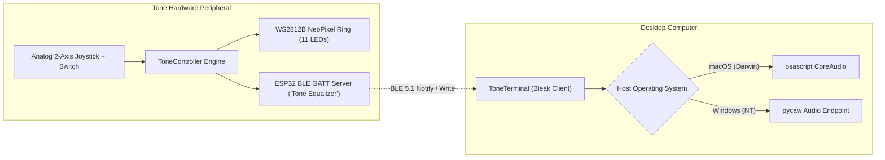

<div align="center">



# Tone

**Tactile Desktop Equalizer and Audio Controller**

[](https://github.com/AtaCanYmc/ToneProject/actions/workflows/ci.yml)
[](https://opensource.org/licenses/MIT)
[](docs/hardware-architecture.md)
[](libs/ToneOS)
[](libs/ToneTerminal)
[](docs/)

<br />



</div>

---

## Table of Contents

- [Overview](#overview)
- [System Architecture](#system-architecture)
- [Hardware Pinout & Electronics](#hardware-pinout--electronics)
- [Interaction Modes & LED Feedback](#interaction-modes--led-feedback)
- [Repository Structure](#repository-structure)
- [Quick Start](#quick-start)
  - [1. Firmware Setup (ToneOS)](#1-firmware-setup-toneos)
  - [2. Desktop Companion (ToneTerminal)](#2-desktop-companion-toneterminal)
- [Bluetooth Low Energy Protocol](#bluetooth-low-energy-protocol)
- [Documentation Index](#documentation-index)
- [Credits & License](#credits--license)

---

## Overview

**Tone** is a tactile desktop sound controller that bridges physical haptics with digital audio control. Rather than relying on flat onscreen sliders, Tone translates rotational and tap gestures on an elliptical surface into fluid sound adjustments and real-time optical LED feedback.

> The physical form factor, tactile interaction language, and industrial design of Tone were created by industrial designer **Sezin Sözden** ([sezinsozden@gmail.com](mailto:sezinsozden@gmail.com)) as a graduation project.

The system consists of two primary subsystems:
1. **ToneOS (`libs/ToneOS`)**: C++ embedded firmware running on an ESP32 microcontroller, reading analog joystick coordinates, driving a 270-degree WS2812B NeoPixel optical diffuser arc, and advertising as a Bluetooth Low Energy (BLE) GATT server.
2. **ToneTerminal (`libs/ToneTerminal`)**: Cross-platform Python desktop bridge running on macOS and Windows, pairing automatically with the controller to synchronize and adjust system audio levels in real time.

---

## System Architecture



---

## Hardware Pinout & Electronics

The firmware supports both compact ESP32-C3 boards and ESP32-WROOM development modules:

| Signal / Function | ESP32 Pin (Default) | Alternate DevKit Pin | Hardware Connection | Description |
| :--- | :---: | :---: | :--- | :--- |
| **Joystick X-Axis** | `GPIO 3` | `GPIO 34` | Thumbstick Potentiometer X | 12-bit ADC analog position reading |
| **Joystick Y-Axis** | `GPIO 4` | `GPIO 35` | Thumbstick Potentiometer Y | 12-bit ADC analog position reading |
| **Tactile Push Switch** | `GPIO 5` | `GPIO 25` | Thumbstick Center Button | Digital input (pull-up active) |
| **NeoPixel Data (`DIN`)** | `GPIO 10` | `GPIO 13` | WS2812B LED Ring | Single-wire NRZ timing signal |
| **Power Input** | USB-C (5V) | USB-C (5V) | Charging & Logic Rail | 5V / 2A external or battery powered |

---

## Interaction Modes & LED Feedback

Tapping down on the controller cycles between three independent audio parameters. The integrated NeoPixel arc shifts color and illuminates proportionally ($0\% - 100\%$):

| Mode Index | Parameter | LED Feedback Color | Frequency Target | Description |
| :---: | :--- | :--- | :--- | :--- |
| **0** | **Volume** | Warm White (`#FFFDF0`) | Master Gain | Controls master OS audio level. |
| **1** | **Bass** | Deep Purple (`#8B5CF6`) | $32\text{ Hz} - 250\text{ Hz}$ | Equalization for low-end punch and kick drums. |
| **2** | **Treble** | Vibrant Orange (`#F97316`) | $4\text{ kHz} - 16\text{ kHz}$ | Equalization for acoustic clarity and vocal air. |

---

## Repository Structure

```text
ToneProject/
├── assets/
│   ├── tone-logo.svg           # High-resolution vector brand mark
│   ├── tone-logo.png           # 800x800 rasterized square logo
│   ├── tone-technical-drawing.png # 1600x1129 Sheet DM-495 orthographic CAD drawing
│   ├── renders/                # High-resolution 3D renders from graduation catalog
│   │   ├── tone-hero-desktop.jpg
│   │   ├── tone-modes-press.jpg
│   │   ├── tone-slide-rotate.jpg
│   │   ├── tone-app-ringbutton.jpg
│   │   ├── tone-dual-led-variants.jpg
│   │   ├── designer-sezin-sozden.jpg
│   │   └── developer-atacan-yaymaci.jpg
│   └── pdf/                    # Source graduation project artifacts
│       ├── tone-technical-design.pdf # Sheet DM-495 engineering drawing (Scale 1:1)
│       ├── tone-user-manual.pdf
│       ├── tone-booklet.pdf
│       ├── tone-project-folder.pdf
│       └── tone-board.pdf
├── docs/                       # Technical and design documentation
│   ├── index.html              # Bespoke interactive web simulator & docs portal
│   ├── style.css               # Tone dark studio design system
│   ├── app.js                  # Interactive hardware simulator engine
│   ├── index.md                # Documentation portal markdown
│   ├── design-philosophy.md    # 5N1K research and design background
│   ├── hardware-architecture.md# Exploded assembly, CAD specs and pinouts
│   ├── interaction-and-modes.md# Gesture mechanics and LED logic
│   ├── bluetooth-protocol.md   # BLE GATT architecture & packet format
│   └── user-manual.md          # Complete operation and cleaning guide
├── libs/
│   ├── ToneOS/                 # ESP32 C++ firmware (PlatformIO)
│   │   ├── platformio.ini      # Dual ESP32 & ESP32-C3 build environments
│   │   ├── include/            # C++ headers (ToneController, Bluetooth, etc.)
│   │   └── src/                # Implementation & main.cpp entry point
│   └── ToneTerminal/           # Python desktop companion client
│       ├── main.py             # Discovery loop and client runtime
│       ├── bluetooth_utils.py  # Bleak GATT client and notification handler
│       ├── utils.py            # macOS and Windows system audio bindings
│       ├── requirements.txt    # Platform-aware Python dependencies
│       ├── tests/              # 13 unit tests for volume and BLE parsing
│       └── .env.example        # Environment variable template
├── Makefile                    # Automation commands for build, test, docs & clean
└── README.md
```

---

## Quick Start

### 1. Firmware Setup (ToneOS with PlatformIO)

Compile and flash the firmware using [PlatformIO](https://platformio.org/):

```bash
# Navigate to the firmware directory
cd libs/ToneOS

# Build for default target (ESP32 DevKit)
pio run

# Build for ESP32-C3
pio run -e esp32-c3-devkitm-1

# Upload to connected board
pio run --target upload

# Open serial monitor
pio device monitor -b 115200
```

### 2. Desktop Companion (ToneTerminal)

Run the Python companion client on your computer:

```bash
# 1. Navigate to the client directory
cd libs/ToneTerminal

# 2. Create and activate a virtual environment
python3 -m venv venv
source venv/bin/activate  # On Windows: venv\Scripts\activate

# 3. Install dependencies
pip install -r requirements.txt

# 4. Optional: Configure custom device parameters
cp .env.example .env

# 5. Launch ToneTerminal
python3 main.py
```

ToneTerminal will automatically scan for `Tone Equalizer`, establish the BLE GATT link, read your current system volume, and synchronize the controller.

---

## Bluetooth Low Energy Protocol

| Parameter | Value |
| :--- | :--- |
| **Device Name** | `Tone Equalizer` |
| **GATT Service UUID** | `12345678-1234-1234-1234-1234567890ab` |
| **Characteristic UUID** | `abcdefab-1234-1234-1234-abcdefabcdef` |
| **Properties** | `READ`, `WRITE`, `NOTIFY` |
| **Initial Sync Handshake** | Host writes `vol:<int>` (e.g. `vol:65`) |
| **Event Notifications** | Device notifies UTF-8 JSON: `{"mode": "Volume", "value": "78"}` |

---

## Documentation Index

Comprehensive engineering and design specifications are maintained in the [`docs/`](docs/) directory:
- [Design Philosophy & 5N1K Research](docs/design-philosophy.md)
- [Hardware Architecture & Pinouts](docs/hardware-architecture.md)
- [Interaction Mechanics & Sound Modes](docs/interaction-and-modes.md)
- [Bluetooth Protocol Specification](docs/bluetooth-protocol.md)
- [User Manual & Maintenance Guide](docs/user-manual.md)

---

## Credits & Academic Attribution

- **Industrial Design & Product Concept**: **Sezin Sözden** ([sezinsozden@gmail.com](mailto:sezinsozden@gmail.com) · [Graduation Catalog](https://www.ffadgrad.ieu.edu.tr/id-projects/sezin-sozden) · [Portfolio](https://sezinsozden.my.canva.site/portfolio))
  - *Graduation Project 2025* · **İzmir University of Economics** (Faculty of Fine Arts and Design, Department of Industrial Design)
  - *Academic Advisors*: Asst. Prof. Can ÖZCAN, Lect. Özgür Deniz ÇETİN, Res. Asst. Anıl Dinç DEMİRBİLEK
- **Software & Firmware Architecture**: **Ata Can Yaymacı** ([@AtaCanYmc](https://github.com/AtaCanYmc) · [atacanymc@gmail.com](mailto:atacanymc@gmail.com))
- **Source Code License**: [MIT License](https://opensource.org/licenses/MIT) (c) 2026 AtaCanYmc
