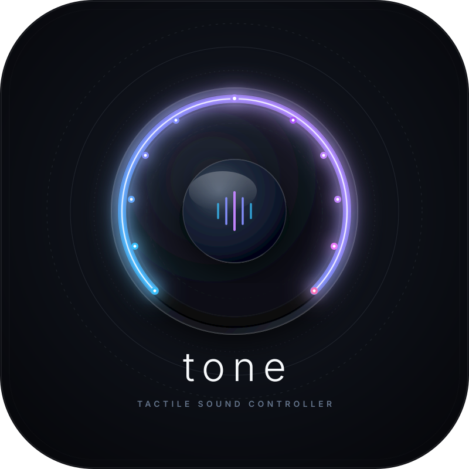

# tone <small>tactile sound controller</small>

> A physical desktop equalizer blending haptic ergonomics with fluid optical feedback.

- Tactile 2-Axis Dial & Momentary Push Control
- 270° Fluid NeoPixel LED Optical Visualizer
- Bluetooth 5.1 Low Energy Desktop Audio Synchronization
- Industrial Design by **Sezin Sözden** · Engineering by **Ata Can Yaymacı**

[GitHub](https://github.com/AtaCanYmc/ToneProject)
[Explore Docs](index.md)
