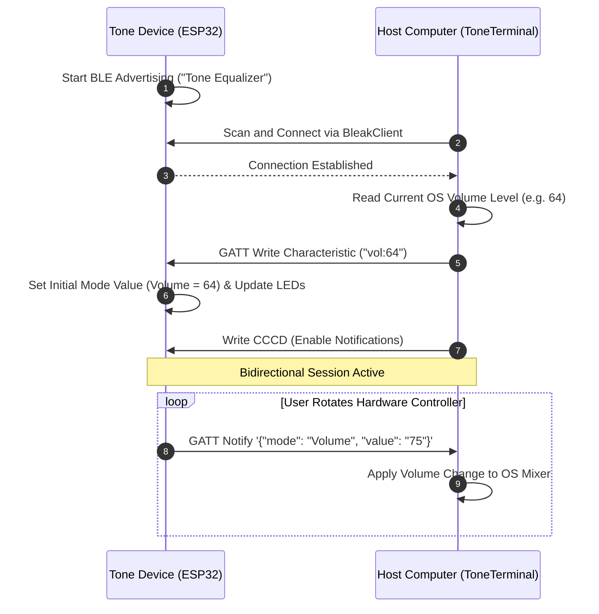

# Bluetooth Low Energy Protocol & Architecture

Tone communicates with host computers and mobile devices over Bluetooth Low Energy (BLE 5.1).

---

## GATT Service & Characteristic Architecture

Tone acts as a BLE GATT Server advertising under the local device name **`Tone Equalizer`**.

| Attribute Type | Identifier (UUID) | Properties | Description |
| :--- | :--- | :--- | :--- |
| **Primary Service** | `12345678-1234-1234-1234-1234567890ab` | None | Primary container service for Tone communications. |
| **Stream Characteristic** | `abcdefab-1234-1234-1234-abcdefabcdef` | Read, Write, Notify | Bidirectional channel for handshake and real-time updates. |
| **Client Characteristic Config (CCCD)** | `00002902-0000-1000-8000-00805f9b34fb` | Read, Write | Standard BLE descriptor used by client to subscribe to notifications. |

---

## Connection Sequence & Handshake



---

## Packet Specifications

### 1. Host to Device: Initial Sync
Sent by the host immediately after connecting:
```text
vol:<integer 0-100>
```
*Example*: `vol:45` synchronizes the device's Volume mode to $45\%$ before the user touches the dial.

### 2. Device to Host: Event Notifications
Emitted by `BluetoothController::sendData` upon joystick rotation or mode updates:
```json
{
  "mode": "Volume",
  "value": "78"
}
```
*Encoding*: UTF-8 string formatted as JSON.

---

## Operating System Audio Adapters

The companion desktop client (`ToneTerminal/utils.py`) intercepts notifications and drives the OS audio engine:

### macOS (`Darwin`)
Directly executes AppleScript via `osascript`:
```bash
osascript -e "set volume output volume <percent>"
```
Querying current volume:
```bash
osascript -e "output volume of (get volume settings)"
```

### Windows (`nt`)
Interfaces with the Core Audio Windows Mixer API via `pycaw`:
```python
from pycaw.pycaw import AudioUtilities, IAudioEndpointVolume
devices = AudioUtilities.GetSpeakers()
interface = devices.Activate(IAudioEndpointVolume._iid_, CLSCTX_ALL, None)
volume = cast(interface, POINTER(IAudioEndpointVolume))
volume.SetMasterVolumeLevelScalar(percent / 100.0, None)
```
