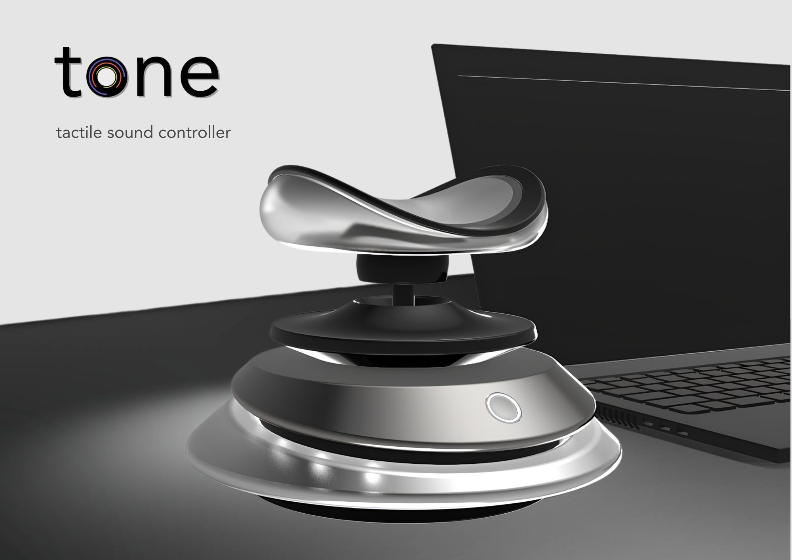
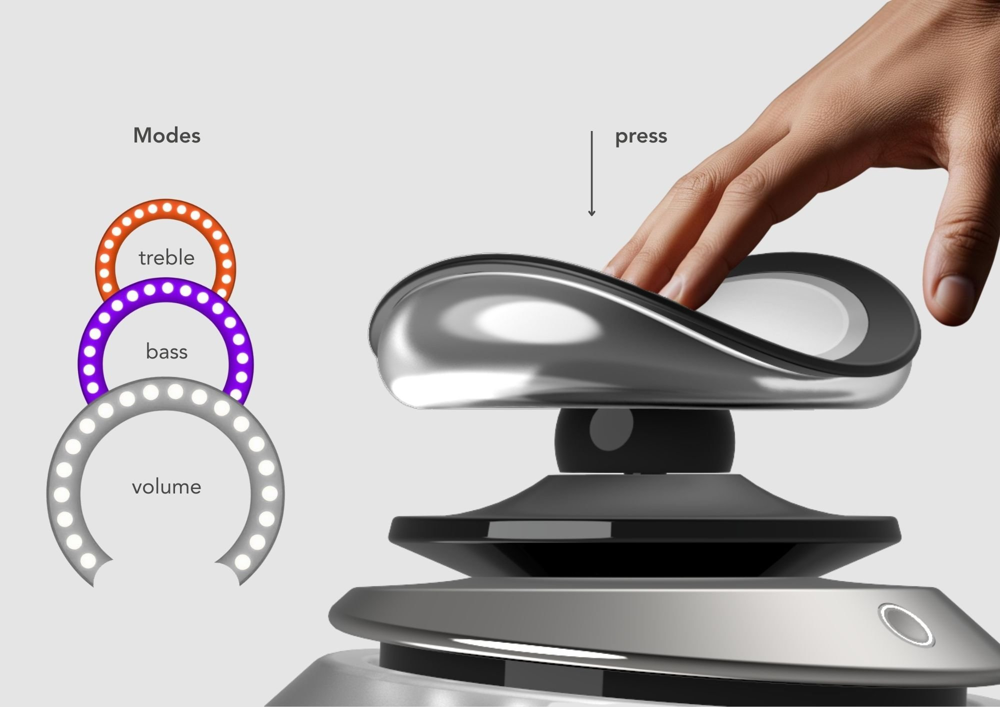
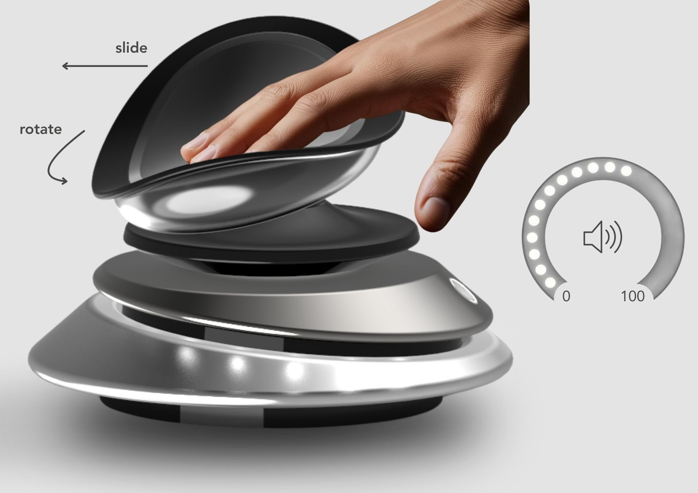
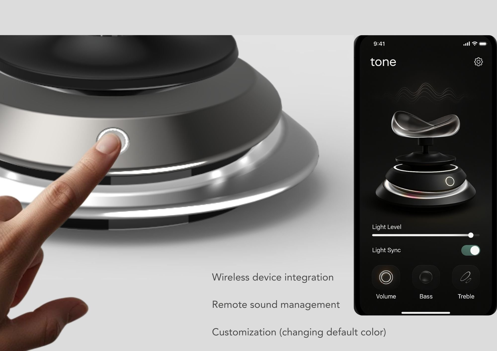
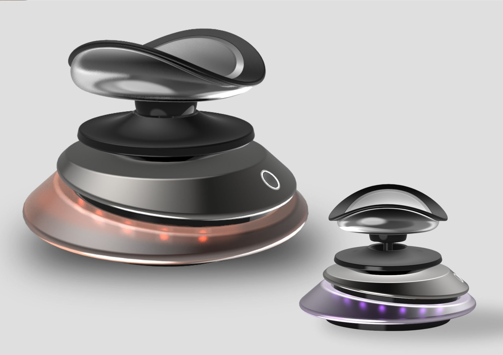

# Design Philosophy & Industrial Design Architecture

Tone is a compact desktop audio controller that redefines how humans interact with digital sound, conceived as an industrial design graduation project by **Sezin Sözden** at **İzmir University of Economics** (Faculty of Fine Arts and Design, Department of Industrial Design).

---

## Academic Context & Credits

| Attribute | Details |
| :--- | :--- |
| **Project Title** | **TONE — Tactile Sound Controller** |
| **Industrial Designer** | **Sezin Sözden** ([sezinsozden@gmail.com](mailto:sezinsozden@gmail.com) · [Graduation Catalog](https://www.ffadgrad.ieu.edu.tr/id-projects/sezin-sozden) · [Portfolio](https://sezinsozden.my.canva.site/portfolio)) |
| **Institution** | İzmir University of Economics (İzmir Ekonomi Üniversitesi) |
| **Faculty & Department** | Faculty of Fine Arts and Design (FFAD) · Department of Industrial Design |
| **Academic Coordinators** | Asst. Prof. Can ÖZCAN, Lect. Özgür Deniz ÇETİN, Res. Asst. Anıl Dinç DEMİRBİLEK |
| **Firmware & Software Engineering** | **Ata Can Yaymacı** ([atacanymc@gmail.com](mailto:atacanymc@gmail.com)) |
| **Catalog Year** | 2025 |

---

## Official Project Statement

### English
> *"Tone is a compact desktop audio controller that redefines the way we interact with sound. At the heart of its design lies an elliptic-shaped control stick, enabling intuitive control over volume, bass, and treble. By rotating the control stick clockwise or counterclockwise, users can precisely adjust sound parameters, while an LED arc visually reflects the intensity level. A single press on the top switches between modes—white for volume, purple for bass, and orange for treble—providing instant visual feedback. Tone connects via Bluetooth to computers and mobile devices, controlling the sound output digitally while maintaining the original audio source. It also includes a complementary mobile application, enabling the same level of control through a digital interface. Designed with both visual aesthetics and user ergonomics in mind, Tone brings together analog tactility and digital convenience—making everyday audio experiences more engaging, personal, and seamless."*

### Türkçe
> *"Tone, sesle etkileşim şeklimizi yeniden tanımlayan kompakt bir masaüstü ses denetleyicisidir. Tasarımının merkezinde, ses, bas ve tiz üzerinde sezgisel kontrol sağlayan eliptik şekilli bir kontrol çubuğu yer alır. Kontrol çubuğunu saat yönünde veya saat yönünün tersine döndürerek kullanıcılar ses parametrelerini hassas bir şekilde ayarlayabilirken, bir LED yayı yoğunluk seviyesini görsel olarak yansıtır. Üst tarafa tek bir basış, ses için beyaz, bas için mor ve tiz için turuncu modlar arasında geçiş yaparak anında görsel geri bildirim sağlar. Tone, Bluetooth aracılığıyla bilgisayarlara ve mobil cihazlara bağlanır ve orijinal ses kaynağını korurken ses çıkışını dijital olarak kontrol eder. Ayrıca, dijital bir arayüz aracılığıyla aynı kontrol seviyesini sağlayan tamamlayıcı bir mobil uygulama içerir. Hem görsel estetik hem de kullanıcı ergonomisi düşünülerek tasarlanan Tone, analog dokunsallığı ve dijital kolaylığı bir araya getirerek günlük ses deneyimlerini daha ilgi çekici, kişisel ve sorunsuz hale getirir."*

---

## Visual Design Gallery & Production Renders

*Figure 1: Tone tactile sound controller deployed on a desktop workstation via wireless Bluetooth.*

*Figure 2: Instant optical feedback through top push gesture — White for Volume, Purple for Bass, Orange for Treble.*

*Figure 3: Ergonomic palm contour with slide and rotate gestures driving 0–100 radial parameter scaling.*

*Figure 4: Tilted chassis ring button integration and companion dark-mode mobile application interface.*

*Figure 5: Ambient diffused LED arc glow across bass (purple) and treble (orange) excitation states.*

---

## The Problem Statement

Sound interfaces in consumer electronics have largely shifted toward flat touchscreens, software sliders, and generic keyboard shortcuts. While digital audio tools offer high technical control, physical interaction is detached:

1. **Lack of Engaging Interaction**: Traditional sliders and buttons provide only mechanical or virtual resistance without tactile nuance.
2. **Weak Visual-Auditory Connection**: Sound adjustments are invisible until heard. Level changes are rarely represented by fluid, ambient physical lighting.
3. **Disconnection from Space**: Conventional peripherals are utilitarian plastic boxes rather than sculpted desktop objects that blend with high-end audio setups.

---

## 5N1K Research Framework

| Question | Answer |
| :--- | :--- |
| **What?** | A tactile desktop equalizer device enabling physical rotation and tap gestures to control volume, bass, and treble with immediate optical LED feedback. |
| **Why?** | To turn sound adjustment from an uninspired mechanical routine into an engaging, multi-sensory experience. |
| **Who?** | Audio professionals working from home, music producers, gamers, and audio enthusiasts seeking tangible desk peripherals. |
| **Where?** | Home studios, desktop music setups, listening rooms, and creative workstations. |
| **When?** | Everyday audio playback, continuous listening, mixing, and focused media sessions. |
| **How?** | An analog 2-axis joystick module with a central push-button is mounted beneath an elliptical rotatable surface, driving a 270-degree RGB LED arc that mirrors sound levels. |

---

## Ergonomics and Form Language

Tone combines minimalist geometry with organic tactile curves:
- **Central Concave Saddle & Elliptical Disk**: Natural palm/finger resting surface allowing smooth circular motion without wrist strain.
- **Translucent Light Diffuser**: Hidden-until-lit optical polycarbonate ring that softens point-source NeoPixels into a seamless arc casting ambient light onto desk surfaces.
- **Weighted Stability**: A 320g desktop footprint and $\varnothing 205\text{ mm}$ base diameter prevent unintentional sliding during single-handed operation.
- **Materials & Finishes**: Brushed and polished silver metallic base skirt, dark gunmetal anodized chassis housing, and matte black soft-touch top control saddle.
