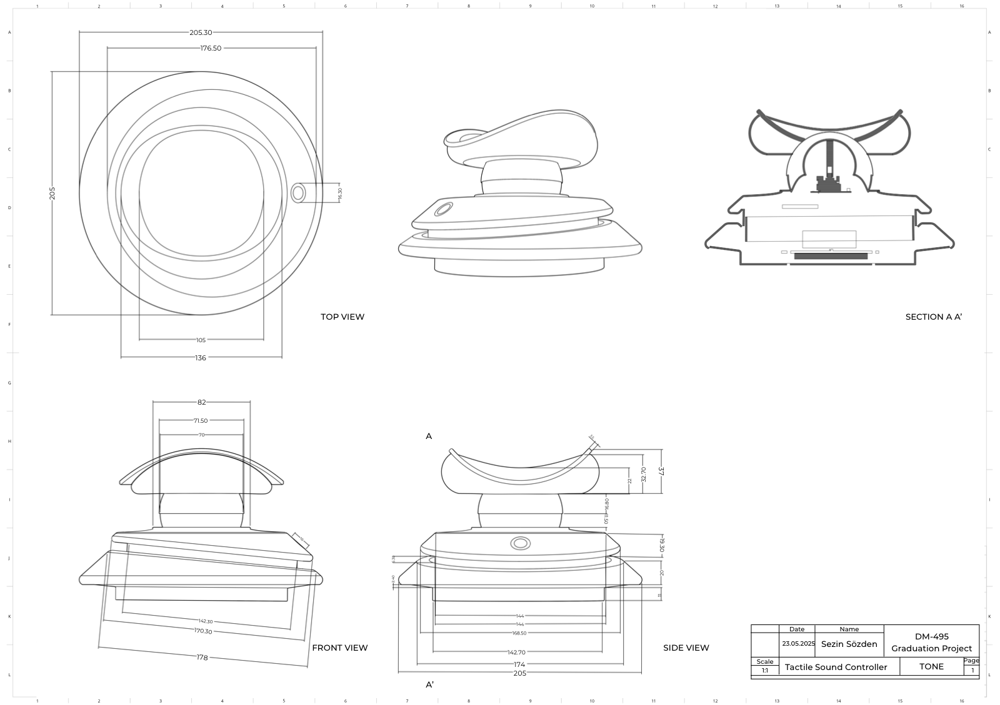
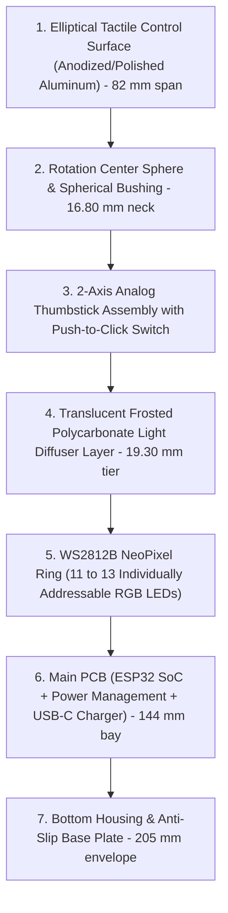

# Hardware Architecture & Electronics

Tone integrates custom mechanical components with an ESP32 microcontroller, an analog thumbstick assembly, and a multi-element NeoPixel LED ring.

---

## Technical Drawing & Orthographic Projections (Sheet DM-495)

The physical architecture and production tolerances are defined in official engineering drawing **Sheet DM-495** (Scale 1:1, Date: 23.05.2025, Designer: Sezin Sözden).

### Drawing Metadata & Sheet Standards

| Parameter | Specification | Notes |
| :--- | :--- | :--- |
| **Document ID** | `DM-495` | Graduation Project Technical Drawing |
| **Project Title** | `Tactile Sound Controller TONE` | Official Industrial Design Nomenclature |
| **Designer** | **Sezin Sözden** | Industrial Design & CAD Modeling |
| **Date of Issue** | `23.05.2025` | Production Drawing Release |
| **Engineering Scale** | `1:1` | Full scale orthographic projections (mm) |

---

## Millimeter Dimension Matrix (from Sheet DM-495)

### 1. Top Projection (Top View)
- **Outer Plan Envelope**: $205.30\text{ mm} \times 205.00\text{ mm}$
- **Concentric Bezel Diameter**: $\varnothing 176.50\text{ mm}$
- **Recessed Control Apron**: $\varnothing 136.00\text{ mm}$
- **Inner Spherical Socket Aperture**: $\varnothing 105.00\text{ mm}$
- **Rear Push-Button / Charge Recess**: $16.30\text{ mm}$ width

### 2. Front & Side Projections (Elevation)
- **Top Sculpted Saddle (Finger Rest Disk)**:
  - Outer horn span: $82.00\text{ mm}$
  - Inner contour diameter: $\varnothing 71.50\text{ mm}$
  - Dish center recess: $\varnothing 70.00\text{ mm}$
  - Dish depth / bowl radius: $32.70\text{ mm}$
  - Wall thickness: $3.00\text{ mm}$ (lip margin $4.30\text{ mm}$, total saddle height $37.00\text{ mm}$)
- **Spherical Ball Pivot (Bushing Joint)**:
  - Height of visible spherical neck: $16.80\text{ mm}$
  - Transition neck radius: $5.80\text{ mm}$
- **Upper Diffuser & Mid Tier**:
  - Slanted diffuser apron height: $19.30\text{ mm}$
  - Stepped base ring diameters: $\varnothing 178.00\text{ mm}$, $\varnothing 170.30\text{ mm}$, $\varnothing 142.30\text{ mm}$
- **Bottom Base Chassis**:
  - Overall skirt diameter: $\varnothing 205.00\text{ mm}$
  - Mounting step rim: $\varnothing 174.00\text{ mm}$, $\varnothing 168.50\text{ mm}$
  - Base tray recess: $\varnothing 144.00\text{ mm}$, $\varnothing 142.70\text{ mm}$
  - Base vertical depth: $20.00\text{ mm}$ with $2.40\text{ mm}$ and $5.30\text{ mm}$ mounting reveals
  - USB-C port cutout: $11.50\text{ mm} \times 3.50\text{ mm}$

### 3. Total Height Stackup Calculation
$$\text{Total Height} = 37.00\text{ mm (Saddle)} + 16.80\text{ mm (Ball Neck)} + 19.30\text{ mm (Diffuser Tier)} + 20.00\text{ mm (Base)} = \mathbf{93.10\text{ mm}}$$

---

## Internal Mechanism & Cross-Section (Section A-A')

Section cut $A-A'$ through the central vertical axis exposes the electromechanical integration:
1. **Vertical Actuator Shaft**: The thumbstick steel rod extends up into the spherical bushing, transferring rotational deflection directly to the dual $10\text{k}\Omega$ potentiometers below.
2. **Hollow Wire Conduit**: A central coaxial channel through the ball pivot routes signal lines from the upper tactile button to the main circuit board.
3. **Diffuser Integration Shelf**: The translucent frosted polycarbonate diffuser ring is clamped between the aluminum upper housing and the weighted ABS base chassis.
4. **Internal Bay**: Accommodates the horizontal ESP32 mainboard, power regulation circuitry, and USB-C port aligned with the $11.50\text{ mm} \times 3.50\text{ mm}$ aperture.

---

## Mechanical Exploded View

The hardware stack is organized in vertical layers from top to base:

---

## Physical Specifications

| Parameter | Specification | Notes |
| :--- | :--- | :--- |
| **Footprint Dimensions** | $205.30\text{ mm} \times 205.00\text{ mm}$ | Precise envelope per Sheet DM-495 |
| **Total Assembled Height** | $93.10\text{ mm}$ | Dimensioned stackup ($37 + 16.80 + 19.30 + 20\text{ mm}$) |
| **Total Weight** | $320\text{ g}$ | Weighted base with high-friction silicone pads |
| **Enclosure Materials** | Polished & bead-blasted aluminum alloy, matte ABS chassis | High structural rigidity |
| **Diffuser Material** | Optical-grade frosted translucent polycarbonate | Eliminates LED hotspots |
| **Power Input** | 5V / 2A via USB Type-C ($11.5 \times 3.5\text{ mm}$) | Supports operation while charging |
| **Battery / Internal Circuit** | 3.7V Li-ion battery circuit with integrated PMIC | Provides standalone wireless operation |

---

## Microcontroller & GPIO Pinout

ToneOS is implemented on the ESP32 platform. Two hardware pin configurations are supported across board revisions:

### Revision A (ESP32-C3 / Custom Compact Board)
Configured in `libs/ToneOS/src/main.cpp`:

| Function | Pin Name | Hardware Connected | Signal Type |
| :--- | :--- | :--- | :--- |
| **Joystick X-Axis** | `GPIO3` | Thumbstick Potentiometer X | Analog Input (ADC1) |
| **Joystick Y-Axis** | `GPIO4` | Thumbstick Potentiometer Y | Analog Input (ADC1) |
| **Joystick Button (Switch)** | `GPIO5` | Thumbstick Tactile Switch | Digital Input (Pull-Up) |
| **NeoPixel Data Out** | `GPIO10` | WS2812B Data Line (`DIN`) | Digital Output (Single-Wire NRZ) |

### Revision B (ESP32-WROOM-32 DevKit)
Configured for standard ESP32 development boards:

| Function | Pin Name | Hardware Connected | Signal Type |
| :--- | :--- | :--- | :--- |
| **Joystick X-Axis** | `GPIO34` | Thumbstick Potentiometer X | Analog Input (ADC1_CH6) |
| **Joystick Y-Axis** | `GPIO35` | Thumbstick Potentiometer Y | Analog Input (ADC1_CH7) |
| **Joystick Button (Switch)** | `GPIO25` | Thumbstick Tactile Switch | Digital Input (Pull-Up) |
| **NeoPixel Data Out** | `GPIO13` | WS2812B Data Line (`DIN`) | Digital Output (Single-Wire NRZ) |

---

## Sensor Calibration & Deadzone Logic

The analog joystick reads 12-bit ADC values ($0 - 4095$). In `JoyController.cpp`, values are normalized:
1. **Origin Calibration**: Center rest point calibrated at boot (`originX`, `originY`).
2. **Deadzone Filtering**: Variations within a configurable threshold ($\pm 35$ ADC units) around center are discarded to eliminate jitter.
3. **Angular Vector Mapping**: $X$ and $Y$ Cartesian deviations are converted via `atan2(y, x)` into degrees ($0^\circ - 360^\circ$) to determine circular rotation velocity and direction.
