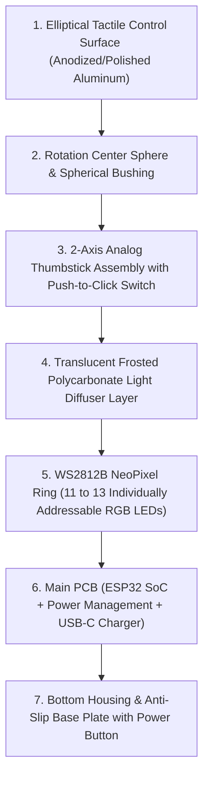

# Hardware Architecture & Electronics

Tone integrates custom mechanical components with an ESP32 microcontroller, an analog thumbstick assembly, and a multi-element NeoPixel LED ring.

---

## Mechanical Exploded View

The hardware stack is organized in vertical layers from top to base:

---

## Physical Specifications

| Parameter | Specification | Notes |
| :--- | :--- | :--- |
| **Footprint Dimensions** | 200 mm x 200 mm x 45 mm | Circular footprint with low desktop center of gravity |
| **Total Weight** | 320 g | Weighted base with high-friction silicone pads |
| **Enclosure Materials** | Polished & bead-blasted aluminum alloy, matte ABS chassis | High structural rigidity |
| **Diffuser Material** | Optical-grade frosted translucent polycarbonate | Eliminates LED hotspots |
| **Power Input** | 5V / 2A via USB Type-C | Supports operation while charging |
| **Battery / Internal Circuit** | 3.7V Li-ion battery circuit with TP4056 or integrated PMIC | Provides standalone wireless operation |

---

## Microcontroller & GPIO Pinout

ToneOS is implemented on the ESP32 platform. Two hardware pin configurations are supported across board revisions:

### Revision A (ESP32-C3 / Custom Compact Board)
Configured in `libs/ToneOS/toneOS.ino`:

| Function | Pin Name | Hardware Connected | Signal Type |
| :--- | :--- | :--- | :--- |
| **Joystick X-Axis** | `GPIO3` | Thumbstick Potentiometer X | Analog Input (ADC1) |
| **Joystick Y-Axis** | `GPIO4` | Thumbstick Potentiometer Y | Analog Input (ADC1) |
| **Joystick Button (Switch)** | `GPIO5` | Thumbstick Tactile Switch | Digital Input (Pull-Up) |
| **NeoPixel Data Out** | `GPIO10` | WS2812B Data Line (`DIN`) | Digital Output (Single-Wire NRZ) |

### Revision B (ESP32-WROOM-32 DevKit)
Alternate pinout documented in `libs/ToneOS/toneOS.ino` comments:

| Function | Pin Name | Hardware Connected | Signal Type |
| :--- | :--- | :--- | :--- |
| **Joystick X-Axis** | `GPIO34` | Thumbstick Potentiometer X | Analog Input (ADC1_CH6) |
| **Joystick Y-Axis** | `GPIO35` | Thumbstick Potentiometer Y | Analog Input (ADC1_CH7) |
| **Joystick Button (Switch)** | `GPIO25` | Thumbstick Tactile Switch | Digital Input (Pull-Up) |
| **NeoPixel Data Out** | `GPIO13` | WS2812B Data Line (`DIN`) | Digital Output (Single-Wire NRZ) |

---

## Sensor Calibration & Deadzone Logic

The analog joystick reads 12-bit ADC values ($0 - 4095$). In `JoyController.cpp`, values are normalized:
1. **Origin Calibration**: Center rest point calibrated at boot (`originX`, `originY`).
2. **Deadzone Filtering**: Variations within a configurable threshold ($\pm 35$ ADC units) around center are discarded to eliminate jitter.
3. **Angular Vector Mapping**: $X$ and $Y$ Cartesian deviations are converted via `atan2(y, x)` into degrees ($0^\circ - 360^\circ$) to determine circular rotation velocity and direction.
