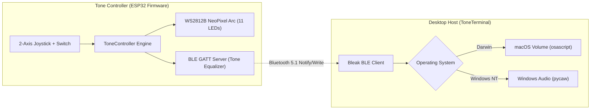

# Tone Documentation Portal

Welcome to the technical and industrial design documentation for **Tone**, a tactile desktop sound controller and hardware equalizer.

---

## Documentation Index

| Document | Description |
| :--- | :--- |
| [Design Philosophy](design-philosophy.md) | Industrial design origin, 5N1K research, tactile interaction model, and design problem definition. |
| [Hardware Architecture](hardware-architecture.md) | Mechanical assembly, exploded views, materials, component layout, and microcontroller pinout specifications. |
| [Interaction & Modes](interaction-and-modes.md) | Gesture mechanics (tap, rotate, tilt), 3 audio parameter modes (Volume, Bass, Treble), and LED arc feedback. |
| [Bluetooth Protocol](bluetooth-protocol.md) | BLE GATT server architecture, service/characteristic UUIDs, JSON packet schemas, and OS volume integration. |
| [User Manual](user-manual.md) | Unboxing, pairing, operation, maintenance, microfiber cleaning instructions, and troubleshooting guide. |

---

## Architectural Summary

Tone bridges physical haptics with digital sound processing:

---

## References & Credits

- **Industrial Design & Concept**: **Sezin Sözden** ([sezinsozden@gmail.com](mailto:sezinsozden@gmail.com) · [Portfolio](https://sezinsozden.my.canva.site/portfolio)) — Graduation Project
- **Software & Firmware Engineering**: **Ata Can Yaymacı** ([@AtaCanYmc](https://github.com/AtaCanYmc) · [ToneProject](https://github.com/AtaCanYmc/ToneProject))
- **Source Documents**: [User Manual](../assets/pdf/tone-user-manual.pdf), [Project Booklet](../assets/pdf/tone-booklet.pdf), [Project Folder](../assets/pdf/tone-project-folder.pdf), [Board Poster](../assets/pdf/tone-board.pdf)
