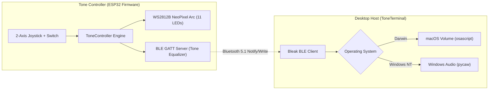

# Tone Documentation Portal

Welcome to the technical and industrial design documentation for **Tone**, a tactile desktop sound controller and hardware equalizer.

---

## Documentation Index

| Document | Description |
| :--- | :--- |
| [Design Philosophy](design-philosophy.md) | Industrial design origin, 5N1K research, tactile interaction model, and design problem definition. |
| [Hardware Architecture](hardware-architecture.md) | Mechanical assembly, exploded views, materials, component layout, and microcontroller pinout specifications. |
| [Interaction & Modes](interaction-and-modes.md) | Gesture mechanics (tap, rotate, tilt), 3 audio parameter modes (Volume, Bass, Treble), and LED arc feedback. |
| [Bluetooth Protocol](bluetooth-protocol.md) | BLE GATT server architecture, service/characteristic UUIDs, JSON packet schemas, and OS volume integration. |
| [User Manual](user-manual.md) | Unboxing, pairing, operation, maintenance, microfiber cleaning instructions, and troubleshooting guide. |

---

## Architectural Summary

Tone bridges physical haptics with digital sound processing:

---

## Source PDF Documents & Downloads

All original project documents from the graduation thesis and engineering design:

| Document | Format | Description | Direct Link |
| :--- | :---: | :--- | :--- |
| **Technical Design CAD (Sheet DM-495)** | PDF (1.2 MB) | Orthographic 1:1 blueprint, sections, tolerances, and USB-C port cutout | [View PDF](assets/pdf/tone-technical-design.pdf) |
| **Tone User Manual** | PDF (4.6 MB) | User onboarding, pairing guide, gesture operations, and care instructions | [View PDF](assets/pdf/tone-user-manual.pdf) |
| **Tone Project Booklet** | PDF (17.9 MB) | 5N1K user research, interaction mechanics, and form exploration studies | [View PDF](assets/pdf/tone-booklet.pdf) |
| **Comprehensive Project Dossier** | PDF (18.6 MB) | Full graduation portfolio folder, sketches, mockups, and CMF palettes | [View PDF](assets/pdf/tone-project-folder.pdf) |
| **Graduation Exhibition Board** | PDF (11.0 MB) | Large-format presentation board with high-res exploded assemblies | [View PDF](assets/pdf/tone-board.pdf) |

---

## References & Credits

- **Industrial Design & Concept**: **Sezin Sözden** ([sezinsozden@gmail.com](mailto:sezinsozden@gmail.com) · [Graduation Catalog](https://www.ffadgrad.ieu.edu.tr/id-projects/sezin-sozden) · [Portfolio](https://sezinsozden.my.canva.site/portfolio))
  - *Graduation Project 2025* · İzmir University of Economics (FFAD)
  - *Advisors*: Asst. Prof. Can ÖZCAN, Lect. Özgür Deniz ÇETİN, Res. Asst. Anıl Dinç DEMİRBİLEK
- **Software & Firmware Engineering**: **Ata Can Yaymacı** ([@AtaCanYmc](https://github.com/AtaCanYmc) · [ToneProject](https://github.com/AtaCanYmc/ToneProject))
