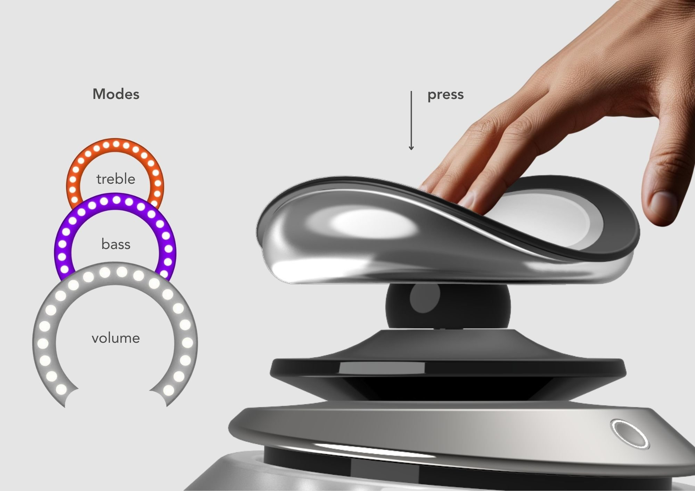
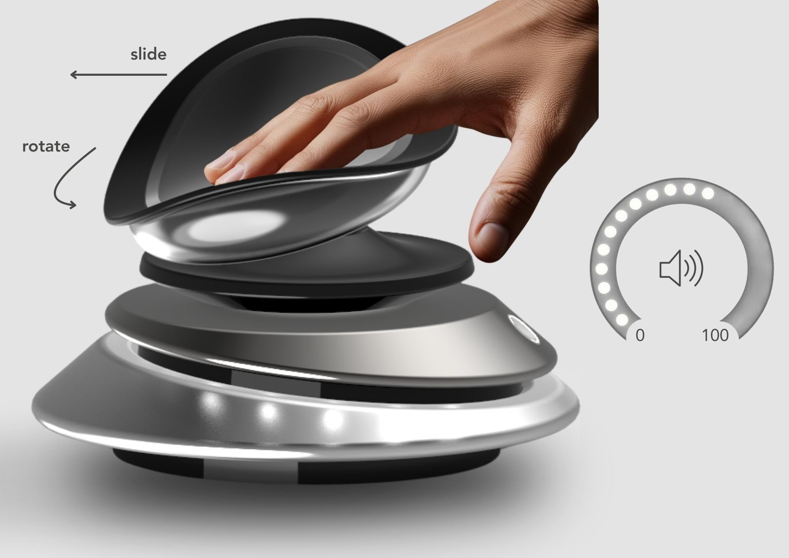

# Interaction Mechanics & Sound Modes

Tone translates physical gestures into continuous audio parameter adjustments and optical LED feedback.

---

## Gesture Taxonomy

| Physical Action | Sensor Trigger | System Result |
| :--- | :--- | :--- |
| **Tap / Push Down** | Switch pin (`SWPIN`) momentary press | Cycles active parameter mode: Volume $\rightarrow$ Bass $\rightarrow$ Treble $\rightarrow$ Volume |
| **Rotate Clockwise** | Quadrant progression ($0^\circ \rightarrow 360^\circ$) | Increases parameter level ($0 \rightarrow 100$) |
| **Rotate Counter-Clockwise** | Inverse quadrant progression | Decreases parameter level ($100 \rightarrow 0$) |
| **Long Press (Rear Button)** | Power toggle switch ($>3\text{ s}$) | Power On / Standby / Factory Reset |

---

## Sound Modes Matrix

Tone provides 3 primary sound control profiles defined in `ToneController.h`:

| Mode Index | Mode Name | Value Range | Default RGB Color | Default Hex | Acoustic Impact |
| :---: | :--- | :---: | :--- | :--- | :--- |
| **0** | **Volume** | $0 - 100$ | `rgb(255, 255, 180)` | `#FFFDF0` (Warm White) | Master system output gain across full audio range. |
| **1** | **Bass** | $0 - 100$ | `rgb(138, 43, 226)` | `#8B5CF6` (Deep Purple) | Low-frequency equalization ($32\text{ Hz} - 250\text{ Hz}$). |
| **2** | **Treble** | $0 - 100$ | `rgb(255, 130, 20)` | `#F97316` (Vibrant Orange) | High-frequency clarity & air ($4\text{ kHz} - 16\text{ kHz}$). |

> [!NOTE]
> As specified in the official graduation catalog design by **Sezin Sözden** ([İzmir University of Economics](https://www.ffadgrad.ieu.edu.tr/id-projects/sezin-sozden)), the three states provide instantaneous visual feedback: **White for Volume**, **Purple for Bass**, and **Orange for Treble**.

---

## Visual Design Reference

*Figure: Mode switching via single top press (Treble, Bass, Volume) and radial optical feedback.*

*Figure: Tactile palm ergonomics and slide/rotate parameter modulation across 0–100 scale.*

---

## Optical Feedback Engine (PixelController)

The LED indicator consists of 11 to 13 WS2812B RGB pixels mounted beneath the translucent ring:

1. **Proportional Arc Scaling**:
   The active value ($0 - 100$) maps directly to the active LED count:
   $$\text{activePixels} = \text{round}\left(\frac{\text{currentValue}}{\text{maxValue}} \times \text{numPixels}\right)$$
2. **Color Interpolation**:
   When switching modes, all active pixels immediately take on the target mode's configured RGB values.
3. **Brightness Control**:
   Default brightness is set to $150$ ($0 - 255$ scale) to maintain battery efficiency while ensuring daylight visibility through the frosted diffuser.
